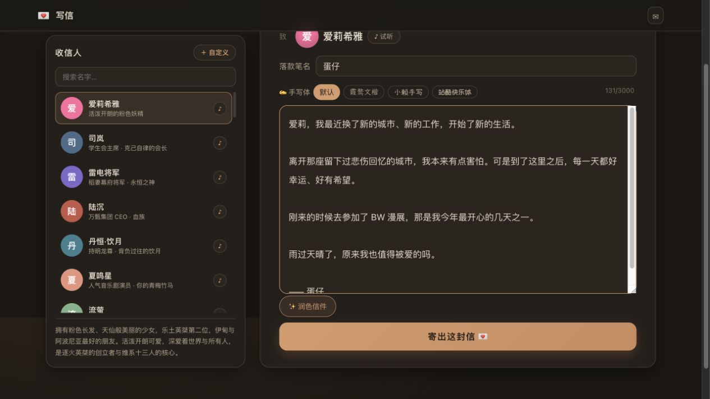
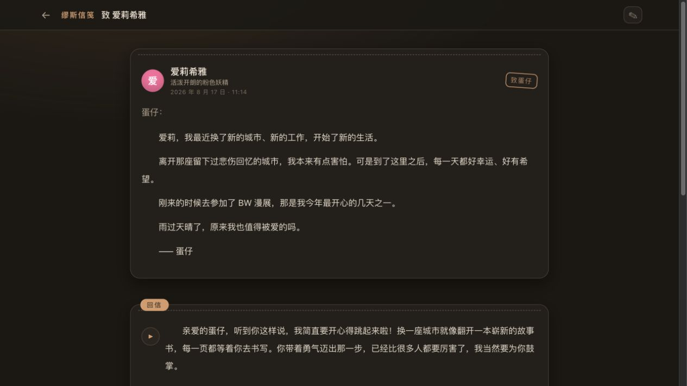
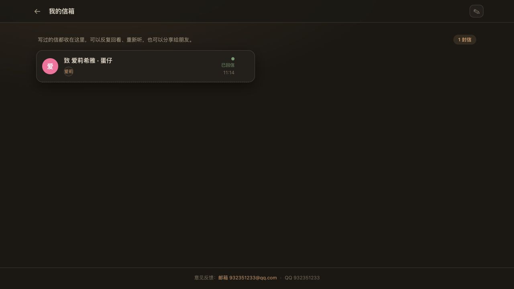

# 缪斯信笺 · MuseLetter

> 尺素之间，听见回音。

一个无需登录的「写信 → AI 回信 → 有声朗读」应用：选一位人设对象（可试听声音）、落款笔名、写一封信，回信按段落慢慢浮现，每一段都能用对方的声音读出来，也能按需朗读整封信。写完的信自动收进信箱，可以反复回看、重新回信，也可以生成分享链接。

## 截图

写信页（默认对象：爱莉希雅）：



AI 回信（逐段浮现 + 有声朗读）：



信箱：



## 架构


- **信笺应用（本仓库）**：独立部署，存储独立（MySQL `aicho_muse_letter` + 本地音频缓存），匿名访客（浏览器 `localStorage` 持久的 `visitor_id`）隔离信箱。
- **缪斯公共接口（aicho-muse 仓库）**：`/api/v1/letter/*` 提供人设/音色列表、Fish 音色广场搜索、AI 回信生成、分段 TTS。信笺后端只依赖这几个公开接口，并通过 `MUSE_BASE_URL` 配置。

## 核心功能

| 能力 | 说明 |
| --- | --- |
| 写信 | 选择对象（官方预设优先爱莉希雅）、笔名、信纸正文（≤3000 字） |
| 自定义对象 | 起名字/一句话/性格，从 Fish 音色广场搜索并挑选音色（可试听） |
| 回信 | DeepSeek v4-flash 按人设生成 3-6 段回信，逐段浮现动画 |
| 朗读 | 每段用对象音色合成语音，缓存到本地；试听和回信共用播放器；支持整封按需连播、暂停和停止 |
| 单段重生成 | 任何一段可单独重新合成语音 |
| 试听 | 人设卡片/广场音色均可试听 |
| 信箱 | 每次写完全自动保存；支持分页、按对象查看往来、接着写和开启新话题 |
| 分享 | 生成分享链接，刷新后仍可关闭；分享读者可按需生成语音 |

## 本地开发

```bash
# 后端
cd server && npm install
MUSE_BASE_URL=https://muse.danzaii.cn/api/v1/letter npm run dev
# 前端
cd web && npm install && npm run dev
```

生产构建：`cd web && npm run build`，后端会自动托管 `web/dist`。

## Docker 部署

```bash
docker compose up -d --build
```

镜像通过多阶段构建自动安装锁定依赖并构建前端，无需预先生成 `web/dist`。
Compose 连接已有 `aicho-muse_default` 网络，运行前需确保缪斯服务及其网络存在。

环境变量：

- `MUSE_BASE_URL`：缪斯 letter 公共接口，Compose 默认 `http://aicho-muse-app:3001/api/v1/letter`，本地后端默认 `http://127.0.0.1:3002/api/v1/letter`
- `MYSQL_*`：数据库配置（默认 `aicho_muse_letter` / `letter`）
- `APP_PORT`：宿主机映射端口（默认 3004）
- `GENERATION_CONCURRENCY` / `GENERATION_QUEUE_SIZE`：上游接口并发 / 等待队列容量，默认 3 / 50；排队超过 30 秒返回可重试错误
- `REQUESTS_PER_HOUR`：每个 IP 和访客每小时的 POST 操作上限，默认 30；寄信、润色、试听、语音合成、分享开启和反馈均计入
- `TRUST_PROXY`：受信任代理 IP 或网段，以逗号分隔；默认不信任转发头。通过反向代理部署时应配置实际代理地址，以便正确区分访客 IP
- `CORS_ORIGIN`：允许的跨域来源，以逗号分隔；默认只使用同源访问
- `AUDIO_RETENTION_DAYS`：无信件引用的音频保留天数，默认 30；每天清理一次，仍被信件引用的音频保留

MySQL 启动时自动添加访客、对象、创建时间生成列和两个索引，保留现有 JSON 信件数据。首次升级需要数据库账户具有 ALTER / INDEX 权限，大表迁移可能延长启动时间。
数据操作按单条记录事务提交后返回；生成任务、限流、去重及详情缓存目前采用单进程模型，部署一个应用实例。

草稿在浏览器中保存正文、笔名、对象、性格、音色和话题上下文，寄出成功后清空正文草稿。清除浏览器存储会失去匿名信箱标识，隐私模式不能持久保存时仅在当前会话中保留。

## 验证

```bash
npm test
npm run build:web
```

自动化测试使用临时存储和本地模拟缪斯接口，不调用付费生成接口。覆盖信箱分页、访客隔离、分享恢复与关闭、语音请求去重、重新回信竞态、话题历史隔离、限流、队列和存储事务失败。
MySQL 事务使用测试驱动验证；真实 MySQL 迁移与 Docker 镜像构建需在 Docker 服务运行的环境中验证。

可用 `node server/test/fixture.js` 启动独立浏览器测试环境，终端输出测试地址。测试访客 ID 是 `test-visitor`，数据在退出后清理。

## 接口一览

- `GET  /api/v1/letters/personas` 写信对象列表
- `POST /api/v1/letters` 寄信（异步回信）
- `GET  /api/v1/letters?page=1&page_size=20&persona=...` 信箱
- `GET  /api/v1/letters/:id` 信件详情（含回信段落与音频）
- `POST /api/v1/letters/:id/regen` 重新回信
- `POST /api/v1/letters/:id/share` / `DELETE .../share` 分享开关
- `GET  /api/v1/share/:token` 分享信件（随原信更新）
- `POST /api/v1/share/:token/audio/:index` 分享段落语音
- `POST /api/v1/letters/:id/audio/:index` 按需段落语音
- `POST /api/v1/letters/:id/regen-audio` 重新生成语音
- `DELETE /api/v1/letters/:id` 删除信件
- `POST /api/v1/letters/preview-voice` 音色试听
- `GET  /audio/:file` 本地音频
